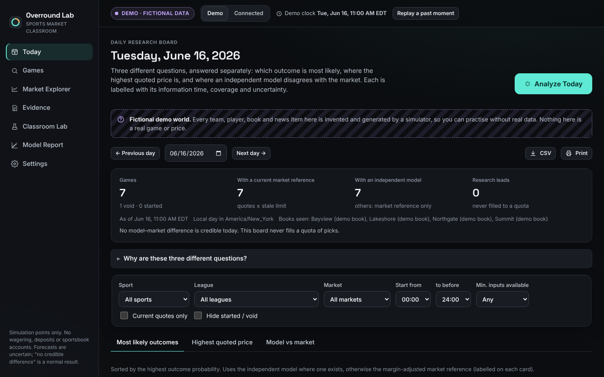

# Overround Lab

A sports forecasting and market-analysis studio for classrooms. It shows how forecasts, market
prices, bookmaker margin, uncertainty and new information fit together, for **MLB, NBA, NFL and
ATP/WTA tennis** (plus market-only views for any other sport The Odds API covers).
**Simulation points only:** there are no deposits, no sportsbook logins, no wagering, no affiliate
links and no staking advice. "Insufficient evidence" and "no credible difference from the market"
are normal, expected results.



---

## 1. Run it

**Requirements:** Node.js **22.13 or newer** (current LTS recommended). Nothing else: no database
server and no native compilation.

```bash
npm install
npm start          # builds the client and server, then serves http://127.0.0.1:5180
```

Open **http://127.0.0.1:5180**. On first start the app generates the fictional demo world
(about 15 seconds, roughly 120 MB in `./data`) and then fits the models in the background (a few
more seconds). Upgrading from an earlier version regenerates the demo world automatically; saved
forecasts are kept.

| Command | What it does |
|---|---|
| `npm start` | Build, then serve on 127.0.0.1:5180 |
| `npm run serve` | Serve an existing build (faster restarts) |
| `npm run dev` | API with auto-restart plus Vite hot reload on http://127.0.0.1:5173 |
| `npm test` | Unit, contract and integration tests (Vitest) |
| `npm run test:e2e` | Build, then run end-to-end tests in Chromium (desktop and mobile) |
| `npm run typecheck` | TypeScript check of server, client and tests |

Configuration lives in `.env` (copy `.env.example`). Stop the app with **Ctrl+C**. To start from
scratch, stop the app and delete the `data/` folder. With connected providers the database grows
with each odds refresh; at default settings that is very roughly 1–3 MB per active day, bounded by
the daily credit cap. Forecasts are immutable, so trimming history means starting a new data folder.

---

## 2. Use it

The top bar always shows the mode: **DEMO · FICTIONAL DATA**, **HISTORICAL REPLAY** (with the
frozen information time) or **CONNECTED DATA**. Switch between Demo and Connected there. Choose
**Replay a past moment** to freeze all information at any earlier time.

| Area | What it is for |
|---|---|
| **Today** | **Analyze Today** refreshes connected providers within your caps (demo: recomputes as of the demo clock), records the day's estimates, and shows three separate views: *Most likely outcomes*, *Highest quoted price* for a chosen outcome, and *Model vs market*. Filters cover sport, league, start time, market, quote freshness and data completeness. Every game shows its as-of time, coverage, probability, evidence summary and an uncertainty statement. CSV export and print are available. |
| **Value Finder** | Today's outcomes ranked by **estimated chance of winning** (with the best price and its break-even chance next to it), and, separately, **price discrepancies**: prices that beat the margin-free consensus of at least 3 books by 1% or more (grade B), model edges only where the model has beaten the market out of sample (grade C), **arbitrage** sets (grade A) and clearly labelled *unproven model ideas* (grade D). A **track record** tab backtests each rule on this season's finished games with 95% intervals and closing line value. No quotas, no "locks": an empty list is a normal answer. |
| **Average Lines** | For every game: the average moneyline, spread and total across books (averaged correctly, on the probability scale), the best and worst price with the book, the margin-free fair price, the average spread/total line and the range of lines offered, and the average bookmaker margin. |
| **Games** | Search by team and open the **game workspace**: raw implied, margin-adjusted market, independent model (with an approximate 80% range), combined estimate, per-book quote table, **spreads and totals** priced from the model's margin and total distributions (with push chances on whole-number lines and a sharpened model + market estimate), quote history chart (with a table view), injuries, lineups, conflicts, source-linked news, weather, a five-question plain-language explanation with source IDs, and **what-if** controls kept visibly separate from confirmed facts. |
| **Market Explorer** | Equivalent contracts across books, each book's margin, price movement, and a margin calculator. |
| **Evidence** | News (official / report / speculation, duplicates grouped), injuries, lineups (unknown stays unknown) and conflicting reports. |
| **Classroom Lab** | Students forecast **before** results are known (model and market can be hidden to avoid anchoring), forecasts are immutable and timestamped, results are revealed later and scored with Brier score and log loss against the model and market on the same games. There is a points-only notebook (100 simulation points per experiment), explainers (probability vs confidence, odds and margin, calibration, EV with pushes, a variance simulator) and instructor controls (demo clock, hide results, new session). |
| **Knowledge Center** | 36 short explainers grouped into prices and probability, value, markets, models, judging forecasts and thinking clearly, with working calculators: odds converter (American, decimal, fractional), four margin-removal methods side by side, EV with pushes, Kelly (theory only), parlays with the correlation warning, arbitrage, hedging, closing line value, a break-even table, a luck-versus-skill season simulator, and responsible-gambling information. |
| **Model Report** | Per sport: chronological train / validation / holdout splits, Brier and log loss against baselines and the market, paired-bootstrap intervals, calibration charts, **spread and total** accuracy against the market, the **market reference settings** (which margin-removal method and book weights were learned, with the evidence), the saved forward record (abstentions included) and limitations. |
| **Settings** | Providers (coverage, licensing, health, quotas, connection test), cost caps, scheduler (pause/resume, run now, last and next run, activity log), time zone, freshness and threshold settings, theme, motion, text size and contrast. |

**A typical class with the demo:** the demo clock starts on Tue 16 Jun 2026 at 11:00 in New York.
Students research games and make forecasts in the Lab. The instructor presses *Advance a day*,
students press *Reveal results*, then compare Brier scores with the model and the market. Repeat.
Use *Replay a past moment* to replay any earlier day the same way.

---

## 3. What works without keys

| Feature | Without any key | Needs |
|---|---|---|
| Demo world (baseball, soccer, basketball, football, tennis), Today board, Value Finder, Average Lines, Knowledge Center, game workspaces, what-ifs, Lab, Report, exports | ✅ fully offline | — |
| MLB schedules, official results, probable pitchers, posted lineups, injured lists, model history | ✅ enable **MLB Stats API** in Settings | internet |
| NFL schedules, results and closing lines, model history | ✅ enable **nflverse** in Settings | internet |
| Tennis (or any sport's) results history from a file you downloaded | ✅ **Settings → Import results (CSV)** | a results file |
| NBA schedules and results, model history | — | free `BALLDONTLIE_API_KEY` |
| Venue weather | ✅ enable **Open-Meteo** | internet |
| News headlines | ✅ enable **News feeds** and list feed URLs | internet |
| Market quotes (any sport The Odds API covers), recent scores for odds-only sports | — | `ODDS_API_KEY` |
| Optional AI-written explanation | — | `ANTHROPIC_API_KEY` and enabled in Settings |

Connected mode **never** fills gaps with demo data. With no providers enabled, the connected
board is empty and says so.

---

## 4. Connecting providers

All providers are **off by default**. Turn them on in **Settings → Providers & coverage**, then press
**Test connection**. Each card shows coverage, history, licensing, cost notes, health, today's usage,
and the sports and books actually observed on your installation.

### MLB Stats API: schedules, results, lineups, injured lists (no key)
- Endpoint `statsapi.mlb.com/api/v1` (teams, schedule with `probablePitcher,lineups,venue` hydration,
  40-man rosters). MLB publishes no formal public documentation. Every response carries an MLB
  Advanced Media copyright notice (gdx.mlb.com/components/copyright.txt) that limits use to
  individual, non-commercial, non-bulk purposes. Check that your use complies.
- Official status mapping: only `Final` / `Completed Early` count as final. `Game Over` waits for the
  official final. Postponed games are void. A make-up keeps the same game ID; forecasts made for the
  original date are void because the start moved more than 12 hours.
- **The model needs two completed seasons before the forecast season.** Analyze Today imports the
  configured history (default: two previous seasons plus the current one, cached for a week).

### nflverse: NFL schedules, results and closing lines (no key)
- Downloads the community-maintained `games.csv` from the nflverse/nfldata repository (one file,
  cached for 12 hours) and imports the current season plus the number of earlier seasons you choose
  (default 3). Relocated franchises map to today's team (OAK → Las Vegas, SD → LA Chargers, STL → LA
  Rams). `spread_line` in that file is positive when the home team is favoured, so it is stored as the
  home line `−spread_line`.
- Closing moneyline, spread and total are stored as quotes **60 minutes before kick-off**, so they
  can serve as the market reference when the model is evaluated. That timestamp is slightly
  optimistic for the market; the Model Report's comparison is therefore conservative for the model.
- Check the nflverse repository's licence and attribution requirements before redistributing data.

### balldontlie: NBA schedules and results (free key)
- Put `BALLDONTLIE_API_KEY=...` in `.env` (the key is sent in the `Authorization` header and is
  redacted from logs). Enable it in Settings and press **Import history now**. The free tier allows
  about 5 requests a minute, so a season (about 15 pages) takes a few minutes; the app spaces requests
  automatically (set your plan's limit in Settings).
- The daily refresh also fetches the schedule and results around today.

### Results files (CSV import, no network)
**Settings → Import results (CSV)** accepts files you downloaded yourself (up to 19 MB):
- **tennis-data.co.uk** season files saved as CSV (Date, Surface, Best of, Winner, Loser, Wsets,
  Lsets, Comment, and PSW/PSL, AvgW/AvgL closing odds when present). Retirements and walkovers are
  skipped. The two players are listed alphabetically (tennis has no home side). Closing odds are stored
  60 minutes before an approximate noon start.
- A **generic** format for any sport: `date, home, away, home_score, away_score` and optionally
  `time` (UTC), `neutral`, `surface`, `best_of`.

Imported games are matched to games already in the database (same teams, start within 2.5 hours, or
the same day for date-only files) so odds stay attached, and re-importing is idempotent.

### The Odds API (v4): market quotes
1. Get a key at the-odds-api.com and put `ODDS_API_KEY=...` in `.env`. Restart.
2. In Settings set the sport keys (e.g. `baseball_mlb`, `basketball_nba`, `americanfootball_nfl`,
   `soccer_epl`), regions, markets (add `spreads` and `totals` for basketball and football lines),
   and a **daily credit cap** and **minimum remaining credits**. Defaults: `h2h`, `us`, cap 30.
   Each tennis tournament is its own key (e.g. `tennis_atp_wimbledon`); tick **Also refresh every
   active tennis tournament** to follow the tour automatically (each tournament costs credits).
3. Press **Test connection**. It calls `/v4/sports`, which the docs say is free, and lists the active
   sports for your key.

Documented behaviour this adapter relies on (verify against the current docs; plans change):
odds cost = markets × regions credits per request (empty responses free); scores cost 1, or 2 with
`daysFrom` (1–3 days); historical snapshots are paid-plan only, cost 10× and are available from
June 2020. Usage headers `x-requests-remaining / -used / -last` are recorded. Requests are refused
locally before they would exceed your caps. A 401 quota response pauses paid calls until a free
connection test shows credits again.

MLB quotes attach only to official MLB schedule events (matched by team aliases and start time,
which handles doubleheaders), so enable the MLB Stats API too. For NFL and NBA, quotes attach to the
nflverse or balldontlie schedule event when there is one; otherwise the event comes from the odds
feed itself and is settled from its scores endpoint. Tennis tournaments share one ATP or WTA player
list (so ratings follow players across tournaments); names like "Novak Djokovic" also match
"Djokovic N." from results files. Tennis results come from imported files, not from the scores
endpoint.

### Open-Meteo: weather (no key)
Hourly forecast at the venue's coordinates (MLB venues), outdoor venues only. The free tier is for
non-commercial use with documented limits (under 10,000 calls a day). Data is CC BY 4.0 and the app
shows "Weather data by Open-Meteo.com".

### News feeds (RSS/Atom, no key)
Only the https feeds you list are fetched (default: the MLB.com news feed; confirm it still exists).
Each request is restricted to the feed's own host and refused if DNS resolves to a private, loopback
or link-local address. Headlines, links and publication times are stored; full articles are not
copied. Claim type (official / report / speculation) is a labelled keyword heuristic.

### Optional AI explanations (Anthropic API)
Set `ANTHROPIC_API_KEY`, then enable it in Settings and set a daily request cap (default 20). Model
`claude-opus-5-5` by default (`AI_MODEL` overrides). One request is made per click, at low effort,
with server-side fallback enabled. The model receives only computed results and source metadata,
never page bodies or secrets. Its reply is **rejected** if it states a percentage the app did not
compute or cites an unknown source, and the deterministic summary is shown instead. It never
changes a number.

---

## 5. Actual coverage and known limitations

- **"All sportsbooks" is not a coverage claim.** Prices are always the *highest quoted price among
  connected sources as of [time]*. The books seen per sport are listed in Settings after a refresh.
- **Independent model:** MLB, NBA, NFL and ATP/WTA tennis (and the fictional baseball, basketball,
  football and tennis leagues): 2-way moneylines, plus spreads and totals for basketball and football.
  It needs two completed seasons of results before the season being forecast (import them first).
  Soccer 1X2, NHL and other sports show the **market reference only**, labelled "no independent
  forecast available". Tennis spreads and totals (games handicaps) are not modelled.
- **Contracts are never mixed:** soccer `h2h` is treated as 3-way regulation time (draw included).
  US-sport `h2h` is treated as full game including overtime, and `h2h_3_way` as regulation-only.
  Bookmaker rules can differ, so check them if precision matters.
- **Settlement:** postponed, cancelled or rescheduled (start moved more than 12 h) means void. An
  official tie in a 2-way market is void. 3-way markets settle only on a known regulation-time score.
  For the Odds API that means an allow-list of leagues with no extra time at any stage (EPL, La Liga,
  Bundesliga, Serie A, Ligue 1, Primeira Liga). Cups and leagues with play-offs (e.g. MLS) are
  "unsupported", not guessed. Suspended games wait for the official completion.
- **Classroom integrity:** forecasts are accepted only before the start by the information time.
  Replay forecasts on games already played by the real clock are kept but scored on separate rows,
  and they can never earn simulation points.
- **Injuries:** MLB injured-list status only (no day-to-day list). Injuries and lineups are evidence;
  no numeric effect is applied without a validated method, so nothing is double-counted.
- **Live scores** are not modelled. Analysis is pre-game and frozen at the scheduled start once a
  game begins.
- The app does not watch broadcasts or read article text.
- **Not live-verified:** the build environment's network blocked every provider host, so the adapters
  are verified against recorded-format responses only (see §9). The first successful live call on
  your machine is shown on each provider card.

---

## 6. Math and model

**Odds.** American A → decimal d: A > 0 gives d = 1 + A/100; A < 0 gives d = 1 + 100/|A|.
0 and |A| < 100 are rejected, as are malformed or non-finite values. The raw implied probability
is q = 1/d.

**Market reference.** Each book's complete, same-time outcome set has its margin removed with one of
four methods: proportional (p_i = q_i / Σq), power (p_i = q_i^k), Shin (a share z of informed money)
or odds ratio. All are approximations of the market's view, not the true probability. **Per sport,
the method is chosen on the previous completed season** (lowest log loss of the consensus 60 minutes
before each start; the default, Shin, is kept unless another method is better by a visible margin).
Across books, the consensus is the median of each book's adjusted probabilities, renormalised; if
**book weights** learned on the first half of that season also improve its second half, a weighted
average is used instead (books that tracked results better count more). Nothing from the forecast
season is used. Best prices from different books are never combined. A quote is *current* if it was
re-confirmed within the stale limit (default 150 minutes, set to cover the default 120-minute odds
refresh).

**Simulation EV** per 1-point stake: p·d − 1 (= p·(d−1) − (1−p)). The break-even probability is 1/d.
With pushes: p_win·(d−1) − p_loss. A void returns the stake.

**Independent model (`rating-logit-v2`).** A rating system per sport feeds a logistic regression:
- baseball: Elo; basketball and football: Elo with a margin-of-victory multiplier
  (ln(|margin|+1) × 2.2 / (0.001 × winner's Elo edge + 2.2)), so blowouts move ratings more and
  favourites' wins move them less;
- tennis: player Elo with an experience-dependent K (250 / (matches + 5)^0.4, scaled), separate hard,
  clay and grass ratings blended with the overall rating, and no home advantage.

Candidate inputs are home advantage, rating difference, rest-day difference, back-to-back
difference (basketball) and a best-of-five interaction (tennis). K, home bonus, carry-over and the
surface blend are chosen by grid search on a validation season, and an input is kept only if it
improves validation log loss. Weights are learned by maximum likelihood on seasons **before** the
forecast season only. Ratings use only games completed before the information time. The 80% range
comes from the weights' covariance (delta method). It reflects parameter uncertainty only and
understates total uncertainty.

**Spreads and totals.** The expected margin is a least-squares fit on home advantage and rating
difference; the expected total uses both teams' recent points scored and allowed (exponentially
smoothed, shrunk towards the league average each new season). Around these means the app builds a
discrete distribution over whole points: a Normal curve multiplied by **key-number weights** learned
from past games (observed ÷ expected frequency, shrunk with a pseudo-count, pooled for ±m). That
gives the chance of winning, pushing and losing at any line, so EV with pushes is exact for the
model. A **sharpened** estimate blends the model's mean with the mean implied by the market's own
line and price; the blend weight is chosen on the validation season (0 when the market is better).

**Combined estimate:** a logistic blend of model and market fitted on the validation season. It is
labelled as using market odds.

**Value Finder grades.** A: arbitrage, the best prices for every outcome of one contract (same line)
imply less than 100% in total. B: a price beats the margin-free consensus of at least 3 books by 1% or
more (price × consensus probability − 1 ≥ 0.01). C: the model or combined estimate sees at least 1%
EV and the model–market verdict is a research lead (validated out of sample). D: only an unvalidated
estimate sees value. The **backtest** applies rule B, and a "back the favourite" baseline, to this
season's finished games at the quotes known 75 minutes before each start, settles them with the
contract rules, and reports return per point and closing line value (price taken × margin-free
closing probability − 1, closing = 20 minutes before the start), each with a 95% bootstrap interval.

**Model–market verdicts:** a gap is a *research lead* only if (1) the model beat the market **out of
sample** (95% paired-bootstrap interval of the log-loss difference below 0 on at least 200 of this
season's earlier games, with parameters fixed before the season), (2) the market falls outside the
model's 80% range, and (3) the gap is at least 3 points. With fewer holdout games, the validation
season is used, but because the model's settings were chosen on it, the best possible verdict is then
*insufficient evidence*. Otherwise the verdict is *no credible difference*. The board never fills a
quota.

### Evaluation results (fictional demo leagues; methods are real, data is simulated)

Holdout = the 2026 season up to the demo start (16 Jun 2026); parameters were fixed on 2024–2025
(football also uses 2023). Log loss, lower is better; market = consensus 60 minutes before the start.

| Sport (holdout games) | Model | Home-rate baseline | Coin flip | Market | Combined |
|---|---|---|---|---|---|
| Baseball (382) | 0.6737 | 0.6870 | 0.6931 | **0.6537** | 0.6579 |
| Basketball (181) | 0.6712 | 0.6884 | 0.6931 | **0.6396** | 0.6430 |
| Football (80) | 0.6175 | 0.6933 | 0.6931 | **0.6025** | 0.6104 |
| Tennis (337) | 0.6564 | 0.7048 | 0.6931 | **0.6318** | 0.6363 |

- In every sport the model clearly beats the baselines and clearly trails the market, which sees
  injuries, starters and news the model does not. Every model–market gap on the demo board is
  therefore *no credible difference* or *insufficient evidence*; that is the intended lesson.
- Spreads and totals (basketball, main line, pushes excluded): model 0.733 / 0.699 vs market
  0.695 / 0.694. The sharpened blends chose 0–10% model weight on validation, i.e. they mostly
  defer to the market, and match it on the holdout.
- Market settings learned on 2025: Shin's method for baseball, basketball and football, proportional
  for tennis (the methods differ by less than 0.002 log loss); accuracy-weighted books were used for
  tennis only, where they helped on the held-back half of 2025.
- 3-way demo soccer, market only (n = 110): Brier 0.591 vs 0.667 uniform and 0.625 outcome frequency.
- Value Finder backtest to the demo start: the grade-B rule took 372 selections with a mean closing
  line value of +3.9% (interval clearly above 0) but a return of +8% whose 95% interval runs from
  about −7% to +24%, i.e. consistent with luck; backing every favourite returned +0.6% (−4% to +5%)
  with negative closing line value (−1.6%). In the simulator the books' errors are independent,
  which is kinder than real markets, where outlying prices move quickly and winners get limited.

With real data you get the same report once two seasons are imported. If there is too little
history, the app says so instead of producing a backtest.

---

## 7. Background scheduling

Connected providers can refresh on a schedule (**paused by default**): a daily scan at a local time
(full refresh plus an Analyze Today snapshot), odds every 120 minutes (skipped when no games remain),
results every 120 minutes and news every 240 minutes. Settings shows the last run, last success,
next run, a **Run now** button for each job, and the activity log.

**Scans run only while this program is running.** Closing the terminal or shutting down the
computer stops them, and missed runs are not back-filled (the log notes them at the next start). For
unattended daily scans, keep the process running, for example under a service manager (`systemd`,
`launchd`, Windows Task Scheduler running `npm run serve` at log-on) or `pm2`. Your interactive
Claude Code session is not a background worker for this app.

---

## 8. Security and privacy

- Listens on **127.0.0.1** only. Exposing it on a network requires `HOST=…`, `ALLOW_REMOTE=1` and an
  `INSTRUCTOR_PIN`.
- Host-header allow-list (DNS-rebinding protection), a custom header on every write (CSRF), same-origin
  checks, Content-Security-Policy, `X-Frame-Options: DENY`, 200 KB body limit, and Zod validation on
  every input.
- API keys live only in `.env` on the server. They are never sent to the browser and are redacted
  from logs and stored errors. Exports contain no secrets, and CSV cells are protected against
  spreadsheet-formula injection.
- Outbound requests use https only, per-provider host allow-lists, private-network blocking at DNS
  resolution time, redirect re-checks, timeouts, size limits, retries with backoff (respecting
  `Retry-After`), caching and in-flight de-duplication.
- Fetched text is untrusted data: stored as plain text, rendered escaped, and never treated as
  instructions. Feed links that are not http(s) are dropped.
- Forecasts and experiment entries are **immutable** (database triggers block update and delete).
  Starting a new session archives the old one; nothing is deleted.

---

## 9. What was tested, and what needs live credentials

`npm test`: **140 tests** across 9 files, all passing in the build environment. Covers:
- odds math (positive and negative American odds, ±100, round-trips, malformed and zero quotes,
  3-way margin, EV with and without pushes, half-up rounding), the four margin-removal methods,
  fractional odds, Kelly, arbitrage stake splits, parlays, hedging and closing line value,
- the multi-sport model: sport configurations, seasons that cross New Year, margin-of-victory
  multiplier, back-to-back features, discrete distributions (probabilities sum to 1, pushes only on
  whole-number lines, key numbers), the market-implied mean, football key-number learning, tennis
  without home advantage, and market settings learned only from completed earlier seasons,
- Value Finder invariants (no started games, sorted by probability, grade B thresholds exact,
  arbitrage payouts equal), average lines on the probability scale, a deterministic backtest, and
  tennis draws that reveal later rounds only after earlier rounds finish,
- settlement (overtime vs regulation, draws, pushes on lines, void, suspended), equivalent-contract
  matching,
- DST days (23 h and 25 h), games crossing local midnight, southern-hemisphere and non-hour offsets,
- stale, incomplete and mismatched-time quotes, after-start exclusion, never mixing books,
- **leakage** (future quotes, injuries, news and results cannot change an analysis; parameters
  never use the forecast season; started games are frozen at start) and deterministic replay,
- provider contract tests against recorded-format responses (nflverse games.csv with relocated
  teams, neutral sites and closing lines; balldontlie paging, rate spacing and key handling;
  tennis-data.co.uk and generic CSV imports; Odds API NFL quotes attaching to the nflverse schedule
  and tennis tournaments sharing one player list; Odds API odds, scores and historical;
  MLB teams, schedule with make-up, doubleheader, Game Over, suspended, and roster; Open-Meteo;
  RSS and Atom), quota exhaustion, invalid keys, credit caps, 429/5xx retries, caching and
  de-duplication, partial outages, SSRF and allow-list checks, secret redaction,
- API workflows: Host and CSRF checks, PIN, input validation, Analyze Today snapshots, selected game,
  what-if, immutable forecasts, reveal after the clock advances, instructor hide-results, session
  restart, **restart persistence**, connected mode with no demo substitution, scheduler pause and
  resume and DST next-run times, AI-output validation,
- regression tests for every finding of an independent code review: percent-encoded CSRF paths,
  points entries after the start or in someone else's experiment, replay forecasts on finished
  games, regulation scores leaking while results are hidden, historical snapshots that never went
  stale, out-of-range information times, play-off soccer leagues, the doubleheader matching window,
  postponed originals kept for replay, and venue data surviving history imports.

`npm run test:e2e`: **24 Playwright tests** (desktop 1366×900 and Pixel 7), all passing: Analyze
Today with keyboard tab navigation, game workspace with what-if, the full forecast → advance day →
reveal → score loop, replay and connected labels, Value Finder views and track record, Average
Lines, Knowledge Center search and calculators, a football game's spreads and totals, every page
without horizontal overflow,
skip-link focus, theme and reduced-motion preferences, **a clean browser console** asserted in every
test, and an **axe-core accessibility audit of every page in the dark and light themes with zero
violations** (contrast, heading order, keyboard-reachable scroll regions, labels).

| Integration | Implemented | Fixture-tested | Live-verified |
|---|---|---|---|
| The Odds API v4 (odds, scores, sports, historical) | ✅ | ✅ | ❌ needs `ODDS_API_KEY` and network |
| MLB Stats API | ✅ | ✅ | ❌ network blocked in build environment |
| nflverse games.csv | ✅ | ✅ | ❌ network blocked |
| balldontlie (NBA) | ✅ | ✅ | ❌ needs `BALLDONTLIE_API_KEY` and network |
| CSV results import | ✅ | ✅ | works offline |
| Open-Meteo | ✅ | ✅ | ❌ network blocked |
| RSS/Atom feeds | ✅ | ✅ | ❌ network blocked; confirm default feed URL |
| Anthropic API explanations | ✅ | output validation tested | ❌ needs `ANTHROPIC_API_KEY` |

Not verified: real browsers other than Chromium, manual screen-reader walkthroughs (automated axe
checks pass; landmarks, labelled controls, tab roles, table headers, live regions and focus
management are in place), and
Windows/macOS launch (the code is cross-platform; tested on Linux with Node 22).

---

## 10. Operating costs (categories only)

- **Odds data:** The Odds API subscription tier and per-request credits (more markets, regions,
  sports or refreshes cost more; historical snapshots cost 10×). Controlled by the daily cap and
  minimum-remaining settings.
- **AI explanations (optional):** per-token API usage for each click, capped per day.
- **Weather and MLB data:** no fee for individual, non-commercial use within their terms and limits.
  Commercial use needs the providers' own agreements.
- **Hosting:** none by default (your computer). An always-on machine or small server if you want
  unattended scheduled scans.

---

## Project layout

```
shared/     odds and betting math, contracts, settlement, scoring and calibration, time zones (server and client)
server/     Fastify app, SQLite repo (as-of queries), model, market, analysis, board, value finder,
            classroom, evaluation, scheduler, ingest, providers/ (oddsapi, mlb, results: nflverse,
            balldontlie and CSV import, openmeteo, rss), demo world generators, AI layer
client/     React app (pages/, components/), styles
tests/      unit/ (Vitest), e2e/ (Playwright), fixtures/ (recorded-format provider responses)
docs/       PLAN.md: stack choice, milestones, design rules
```
